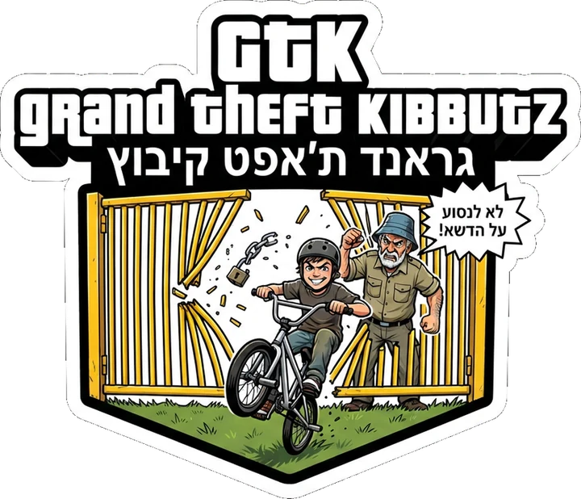

# Grand Theft Kibbutz · גרנד תאפט קיבוץ

<p align="center"></p>

משחק בסגנון GTA2 (מבט מלמעלה), שמתרחש בקיבוץ. אלימות "רכה": מי שחוטף מתעלף לכמה שניות, משאיר מטבעות וקם עצבני.

### 🎮 [לשחק עכשיו בדפדפן](https://idow09.github.io/grand-theft-kibbutz/)

## הרצה

אפשר לפתוח את `index.html` ישירות בדפדפן. אם רוצים לעבוד עם שרת פיתוח:

```
node tools/serve.js      # http://localhost:8790/
```

`tools/mapview.html` הוא כלי פיתוח שמציג את המפה המחוללת. גוררים כדי לזוז, הגלגלת מזיזה זום, ו-`g` מציג את גרף הכבישים.

## שליטה

| פעולה | מקש |
|---|---|
| תנועה / נהיגה | WASD או חיצים |
| ריצה | Shift |
| כניסה/יציאה מרכב, טלפון | E |
| תקיפה / ירי (גם מתוך רכב), ריסוס מהמטוס | F / J / עכבר (וגם Ctrl, לא במק) |
| וו גרירה לעגלה / מחרשה (בטרקטור) | G |
| פרטיקוף: קומביין קוצר / מחרשה למטה | T |
| החלפת נשק | Q / Tab |
| בלם יד / צופר | Space / H |
| רדיו | R |
| קנייה בחנות | 1 / 2 / 3 |
| מפה / השהיה | M / Esc |

**בטלפון:** משחקים לרוחב. ג'ויסטיק משמאל (בנהיגה הרכב פונה לכיוון האגודל), כפתור אדום לתקיפה, ירוק לכניסה/יציאה, ⇄ להחלפת נשק, נגיעה במכ"ם פותחת מפה. ב-iPhone כדאי "הוסף למסך הבית" בשביל מסך מלא.

## מבנה הקוד

| קובץ | תפקיד |
|---|---|
| `js/core.js` | מתמטיקה, RNG, רעש, גיאומטריה, קלט |
| `js/textures.js` | טקסטורות קרקע פרוצדורליות |
| `js/audio.js` | אפקטים, מנוע, אווירה, 6 תחנות רדיו פרוצדורליות |
| `js/world.js` | חומרים, מבנים, אביזרים, התנגשויות, גרף כבישים |
| `js/mapgen.js` | מחולל המפה (תכנון ידני של המבנה הכללי + פרטים פרוצדורליים) |
| `js/ground.js` | אפיית chunks של הקרקע, סימני החלקה, מיני-מפה |
| `js/sprites.js` | כל הגרפיקה: רכבים, אנשים, חיות, עצים, גגות, אייקונים |
| `js/entities.js` | פיזיקת רכבים, בינה מלאכותית, ניהול אוכלוסייה |
| `js/farm.js` | וו גרירה ועגלות, פרטיקוף, קומביין, מחרשה, מטוס ריסוס, השער הצהוב, פרות בורחות |
| `js/gameplay.js` | שחקן, נשקים, רמת רוגז, מוסכים, חנויות, איסופים, בלגן, שמירה |
| `js/missions.js` | שלוש קבוצות, שרשראות סיפור ומשימות חוזרות |
| `js/env.js` | יום/לילה ומזג אוויר |
| `js/render.js` | מבנים בפרספקטיבה תלת-ממדית, צללים, תאורה, מזג אוויר |
| `js/hud.js` | ממשק, מכ"ם, מפה, תפריטים |
| `js/touch.js` | שליטה במגע (ג'ויסטיק, כפתורים, מסך "סובבו לרוחב") |
| `js/main.js` | אתחול ולולאה ראשית |

## קרדיטים

**עדו וייס**, קיבוצניק (כמעט) מלידה, אבל עד היום מרגיש סוג ב׳, כי ההורים היו תושבים, אז שילמתי על שירותים וכלליות בחדר האוכל. היום חבר קיבוץ גאה ואבא לשלוש קיבוצניקיות קטנות שנולדו פה, בקיבוץ סעד. idow09@gmail.com

קוד, גרפיקה וסאונד: Claude (Anthropic).

## רישיון והבהרות

- **קוד:** רישיון MIT, ראו [LICENSE](LICENSE). הלוגו והתמונות בתיקייה `img/` אינם כלולים ברישיון.
- **פרודיה:** פרויקט מעריצים לא מסחרי. אין קשר ל-Rockstar Games, ל-Take-Two או לסדרת Grand Theft Auto, וכל הסימנים המסחריים שייכים לבעליהם.
- **בדיוני:** הקיבוץ, הדמויות והאירועים במשחק בדיוניים. כל דמיון לוותיק שאתם מכירים מקרי בהחלט.
- **פרטיות:** אין עוגיות, אין מעקב ואין איסוף מידע. ההתקדמות נשמרת רק בדפדפן שלכם (localStorage). הגופנים נטענים מ-Google Fonts.
